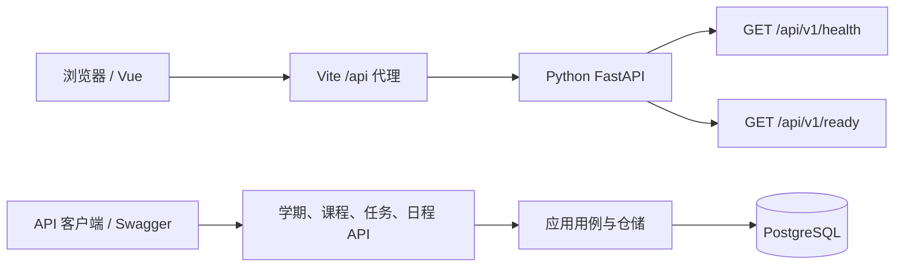
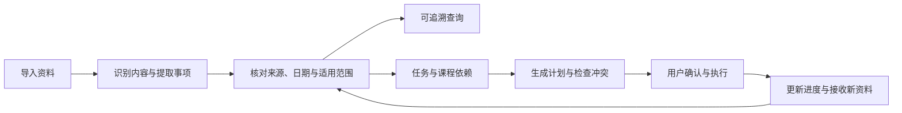

# CampusFlow

**校园学习事务智能助理：把分散的课程资料和通知，整理成有依据、可执行的学习安排。**

CampusFlow 面向学生日常学习中的信息整理与时间管理需求，连接培养方案、课程大纲、教务通知、作业要求和群聊截图，帮助回答三个问题：

- **我需要知道什么？** 查清课程要求、截止时间和办事规则，并找到原文依据。
- **我应该先做什么？** 理清课程和任务的前置关系，形成可解释的执行顺序。
- **接下来怎么安排？** 根据个人时间、任务依赖和截止日期制定计划，发现冲突并跟进变化。

> **项目状态：手动管理闭环与资料导入定位已实现，MVP 开发中。** 当前提供本机登录、工作空间授权及学期／课程／任务／日程管理；本分支汇总了资料上传、解析、定位、后台作业和删除处理。资料页面 D019—D021 已通过本机与 Linux 真实队列闭环验证，M2 验收记录见 [集成验收](docs/verification/M2-integration-acceptance.md)，父组与里程碑最终状态以 GitHub 记录为准；集中核对列表与详情界面、逐字段修正表单与确认后生成正式事项的入口已在本分支接入（R008、R009），问答与学习计划尚待实现。代码存在或单项测试通过不代表整个 MVP 验收通过。

## 开发与架构入口

X007 已提供选定学期内的课程/教学班严格匹配：同名多班或无法匹配时保留原文和人工选项，唯一候选也不自动绑定。核对页面及自动处理入口仍待接入，见 [X007 说明](docs/verification/X007-course-matching.md)。

X006 已提供有依据的相对日期换算：明确发布日期支持“下周三”等表达，适用校历支持教学周；保留原文、计算依据和日期精度，缺依据或含歧义仍待核对。尚未接入自动处理和核对页面，见 [X006 说明](docs/verification/X006-relative-dates.md)。

X001 已建立候选事项、逐字段出处和原文证据的分表存储，新增候选保持待核对，资料删除预览包含候选数量。X002 已提供智谱文字模型接口与严格输出检查，默认型号由用户选定为 glm-4-flash-250414；无效字段、引用和截断输出会被拒绝。自动提取、核对交互及真实模型效果评测仍待后续任务接入。见 [X001 说明](docs/verification/X001-candidate-evidence.md)、[X002 说明](docs/verification/X002-generation-contract.md) 和 [X 系列实施路线](docs/planning/X-IMPLEMENTATION.md)。

X003 已提供任务标题、提交方式、产出物及截止原文的候选提取入口；耗时明确为建议，缺少年份、时刻或提交方式会保留待核对标记，复杂日期不自动转换。自动触发、核对页面与真实效果评测仍待后续接入，见 [X003 说明](docs/verification/X003-progress.md)。

Q001 已提供中文问答合成样本、评测与人工复核工具，真实调用支持预算继承和中断继续。首轮四组发现的问题经严格编号提示词复测：72/72 通过格式及编号检查；状态定义补测的 16/16 符合预期；第二批加入干扰资料与未参与调试的新题后 120/120 通过，四组检索命中率均为 100%，两个向量模型仍分不出高下。第三批**首次跨供应商**（智谱 + DeepSeek），同一日同一网络下三组各答 15 题 × 2 遍、90/90 通过格式及编号检查；三组整体不符数为 4/30、6/30、7/30（全部保留在分母里），剔除三组共有的提示词层面偏差后组特有差异为 DeepSeek-Flash 0 条、GLM-4.5-Flash 2 条、GLM-4-Flash-250414 3 条，仅作附加诊断；延迟中位数 1368／2534／2423 毫秒。选型优先级按维护者本次口径改为**准确率 → 价格 → 稳定性**（延迟降为稳定性的其中一项）。第三批独立语义复核已完成（90 条回答、15 条预标注），四条红线为 0，CIT-SUPPORT 均为 100%，不确定项召回率 DeepSeek-Flash 94.4%／两款 GLM 77.8%；按**准确率 → 价格 → 稳定性**优先选 **DeepSeek-Flash**，Embedding-3 属工程判断。向量模型在同批对照下无法区分，该选择明确标注为工程判断而非数据结论。另记一条型号不确定性：智谱官方公告 GLM-4.5-Flash 将于 2026-01-30 下线并自动路由至 GLM-4.7-Flash（该日期已过），本批账本只回显旧别名、无法确认底层实际版本。所有轮次与失败保留，三笔额度分别列示不合并。第二批 121 行尚未复核，只作历史对照；DeepSeek 条款已于 2026-10-16 核实——数据存境内、API 请求保留期未公开、公开文件没有「不用于训练」的承诺（用户协议 4.3 允许去标识化后用于训练，退出开关在产品内），账号端开关状态仍待账号持有人自查，澄清前不得把真实校务资料发往该接口。Q001 两项验收条件已具备证据。见 [比较记录](docs/verification/Q001-strict-comparison.md)、[模型选型结论](docs/verification/Q001-model-selection.md)、[独立复核](docs/verification/Q001-independent-review.md) 与 [预算及进度](docs/verification/Q001-live-progress.md)。

X004 已提供固定活动候选提取：起止、地点、参加条件保留原文，缺失时间进入待核对；代码保守拦截提交截止被误当活动的结果。尚未接入自动流程和正式日程创建，见 [X004 说明](docs/verification/X004-event-extraction.md)。

R002 已提供候选字段修正记录：追加保存修正前后值、操作者与来源类型，原始提取与证据不改写；用户填写的值只能标为用户补充或规划建议，不能伪装成原文规定。确认、忽略等状态转换由 R003 完成，候选接口与核对界面由 R008 接入，逐字段修正表单由 R009 接入，见 [R002 说明](docs/verification/R002-field-revisions.md)。

R003 已提供候选确认、忽略与失效的状态转换：按类型检查必需字段，缺少必需字段默认拒绝、需显式确认并说明原因；被忽略或已失效的候选不参与正式约束。每次转换留痕操作者与原因，候选接口与核对界面由 R008 接入，确认后生成正式事项的入口由 R009 接入，见 [R003 说明](docs/verification/R003-review-transitions.md)。

R004 已提供已确认任务候选转换为正式任务：在一个事务里关联候选、任务与来源资料，重复转换返回既有任务；只有日期的截止不补时刻，相对写法只保留原文备注。日程转换由 R005 完成，规则候选由 R006 完成；候选接口与核对界面由 R008 接入，生成与打开入口由 R009 接入，见 [R004 说明](docs/verification/R004-task-conversion.md)。

R005 已提供已确认日程候选转换为固定日程：起止必须能解析出日期与时刻，否则拒绝建项；时间按工作空间时区换算并校验区间，重复转换返回既有日程。规则候选由 R006 完成；候选接口与核对界面由 R008 接入，生成与打开入口由 R009 接入，见 [R005 说明](docs/verification/R005-event-conversion.md)。

R007 已提供任务与日程的来源详情接口：区分手动与提取来源，返回原文要求、用户补充与修正记录，以及逐条引用与定位；资料删除后不再返回可验证引用，固定日程一并标记来源失效。核对界面由 R008 接入，见 [R007 说明](docs/verification/R007-source-detail.md)。

R001 已提供待核对事项列表与计数接口：按核对状态（默认只看待核对）、事项类型、课程、学期、来源资料和缺失原因筛选，并给出总数、按状态与按原因的分布计数。核对状态与任务执行进度是两套独立状态，接口只接受核对状态；列表只返回最小字段，逐字段取值与证据仍由来源详情读取，每条都带来源资料与版本号以便查看未覆盖范围。缺失原因代码随 X 系列提取任务补充，见 [R001 说明](docs/verification/R001-review-list.md)。

R008 已提供集中核对界面与其后端支撑：候选详情接口并列给出每个字段的原始提取值与修正后的生效值、原文规定／用户补充／系统推断／规划建议四种出处，以及逐条引用与原文定位；只有仍能定位到原文的引用才标为可验证，资料片段被替换或删除后引用如实标为失效，不伪造位置。核对页面集中列出待核对候选，可按状态、类型、学期、课程、来源资料和缺失原因筛选，逐条展示缺失项、适用范围与来源，并把每条引用直接链接到资料库中该版本的原文片段。确认、忽略与失效转换沿用既有的确认守卫：缺少必须字段时先给出中文原因，需要填写核对说明并显式确认后才转换，核对失败不会被成功提示掩盖。逐字段修正表单与确认后生成正式任务、日程的入口由 R009 接入，见 [R008 说明](docs/verification/R008-review-workbench.md)。

R006 已提供已确认规则候选的转换与保存：标题与规则正文必需，条件、适用范围与生效声明只保留原文不换算；重复转换返回既有规则，未确认候选不能转换。新增按课程／学期过滤的规则查询接口；删除资料时规则保留并标记来源失效。候选接口与核对界面由 R008 接入，界面上的生成入口由 R009 接入，见 [R006 说明](docs/verification/R006-confirmed-rules.md)。

R009 已把逐字段修正与确认后的生成入口接进核对界面：修正沿用 R002 的追加留痕语义，出处只能标为用户补充或规划建议，原始提取与证据不被改写，修正后的取值参与后续转换；确认后可生成正式任务、固定日程或课程规则，重复点击或请求重试命中既有的来源候选关联时返回既有事项并明确提示没有重复创建，生成的条目可从界面直接打开并高亮定位（课程规则只有查询接口，暂不提供跳转），见 [R009 说明](docs/verification/R009-review-actions.md)。

X005 已提供课程规则候选提取：保留完整规定，再单列条件、适用范围和生效信息；代码拒绝删掉条件或例外的短摘录，缺失信息仍待核对。尚未接入正式规则确认和自动流程，见 [X005 说明](docs/verification/X005-rule-extraction.md)。

网页方面，N004 已提供安全抓取，N005 已接通受保护的快照保存和来源记录；N006 已接通 Worker 正文/表格提取与原始位置绑定。仅处理已保存内容，不执行网页脚本或登录。见 [网页快照说明](docs/verification/N005-web-snapshot.md) 和 [网页解析说明](docs/verification/N006-web-parsing.md)；导入与引用查看页面仍待接入。

扩展导入正在分任务推进：N002 已接入普通 DOCX 上传校验，N003 已接通正文/表格解析和版本定位。说明见 [Word 校验](docs/verification/N002-word-validation.md) 与 [Word 解析](docs/verification/N003-word-parsing.md)；资料页面仍待接入。

- [技术选型、目录分层与架构图](docs/ARCHITECTURE.md)
- [本地启动与验证命令](docs/DEVELOPMENT.md)
- [资料处理、Docker Worker 与只读诊断](docs/MATERIAL_PROCESSING.md)
- [贡献指南](CONTRIBUTING.md)
- [Milestone、Issue 拆分与版本标签规则](docs/planning/ROADMAP.md)
- [开发任务索引](docs/planning/ISSUES.md)

工程采用前后端分离的模块化单体：Vue 3 + TypeScript + Vite，Python 3.12 + FastAPI。已接入 PostgreSQL、SQLAlchemy、Alembic，以及 RQ／Redis 独立资料 Worker；Windows 使用 Docker 运行 Worker。pgvector 扩展已配置，向量检索仍待实现。

当前最小调用链：

## 1. 产品定位与服务对象

CampusFlow 以学生个人工作空间为基本单位，提供从学习资料到个人行动的完整流程。

| 服务对象                 | 典型困扰                                       | 预期价值                                 |
| ------------------------ | ---------------------------------------------- | ---------------------------------------- |
| 在校学生                 | 课程信息散落在文件、网页和群聊中，容易遗漏要求 | 集中整理，快速查询原文与关键事项         |
| 同时修读多门课程的学生   | 作业、考试和实验相互挤占时间                   | 统一查看任务与时间安排，提前发现冲突     |
| 规划修课与长期学习的学生 | 不清楚先修关系、开课条件和阶段要求             | 展示课程依赖与缺失条件，辅助制定修读顺序 |

首期聚焦个人学习事务。教师协作、班级管理和学校级教务管理属于后续独立评估范围。

### 产品原则

1. **回答有依据。** 涉及课程要求、日期、规则和依赖关系的事实必须关联来源；没有证据时明确说明。
2. **区分事实与建议。** 原文规定、用户补充、系统推断和规划建议分别标注。
3. **不确定信息可处理。** 缺少年份、截图不完整、版本冲突等情况进入待核对状态，不以猜测代替确认。
4. **安排由用户掌控。** 计划先生成草案；写入外部日历、发送消息、删除资料等敏感操作需明确确认。
5. **变化可追踪。** 保留资料版本、规则变化与计划调整依据，避免旧通知继续影响当前安排。

## 2. 核心业务场景

| 场景         | 用户输入示例                             | 预期输出                                           |
| ------------ | ---------------------------------------- | -------------------------------------------------- |
| 查询课程要求 | “数据库第二次作业什么时候交，交到哪里？” | 截止时间、提交方式、适用对象、原文位置与待核对项   |
| 整理群聊通知 | 上传一组课程群截图                       | 提取作业、考试、变更通知，逐项核对课程和日期       |
| 安排近期学习 | “根据这些资料，安排未来两周的学习。”     | 任务清单、建议时间块、安排理由与无法排入的任务     |
| 检查日程冲突 | “周三实验会不会和考试冲突？”             | 重叠时段、涉及事项、各自来源与处理建议             |
| 梳理修课顺序 | “这些课程应该按什么顺序学？”             | 有证据支持的先修关系、可行顺序、缺失条件及限制说明 |
| 跟进通知变化 | 上传一份修改后的考试通知                 | 新旧信息差异、受影响任务与待确认调整方案           |
| 查询实验要求 | “进入实验室之前要准备什么？”             | 准入条件、必备材料、操作限制及对应原文             |

## 3. 业务闭环

用户可以只查询资料，也可以从已有任务直接制定计划，不必每次走完整个流程。存在歧义的事项可以保存，但必须保留待核对标记，避免被当作已确认的约束使用。

## 4. 功能规划

### 4.1 学期与课程工作空间

- 按学期管理课程、资料、任务和日程，支持归档历史学期。
- 保存课程名称、课程代码、教师、教学班等信息；同名不同教学班分别识别。
- 支持课程别名，将群聊中的简称与正式课程关联；无法唯一匹配时请求核对。
- 维护用户所属年级、专业、培养方案版本和已修课程，判断通知适用范围与先修条件。
- 设置时区、每周可用时段、固定课程、休息时间和学习偏好，供后续排期使用。

### 4.2 资料收集与管理

**拟支持的输入：** PDF、Word、图片与群聊截图、网页通知链接、粘贴文本。网页优先处理公开可访问内容；需要登录或无法读取的页面允许改用上传文件或粘贴原文。

- 资料可归入课程或学期公共资料区，记录标题、发布方、发布时间、导入时间和来源链接。
- 识别文字、表格与扫描内容，保留页码、段落或截图区域等定位信息。
- 展示导入状态：待处理、处理中、完成、部分成功、失败；失败时提供原因和可用的重试方式。
- 检查重复资料和重复事项，建议复用或合并；相似但不同版本的通知不得直接覆盖。
- 支持补充来源信息、重新归类、归档和删除。归档用于保留历史，删除前说明对引用和关联事项的影响。

导入不等于认可内容有效。每份资料都需要保留适用学期、对象与版本信息，防止上一学期或其他教学班的要求混入当前计划。

### 4.3 内容理解与事项提取

从资料中识别四类内容：

| 内容类型 | 主要字段                                             | 示例                             |
| -------- | ---------------------------------------------------- | -------------------------------- |
| 任务     | 所属课程、要求、截止时间、提交方式、产出物、前置条件 | 作业、实验报告、选课申请         |
| 日程     | 开始与结束时间、地点、参与条件、是否可调整           | 考试、实验课、答辩               |
| 规则     | 适用范围、生效时间、条件、限制、来源                 | 实验室准入、提交格式、考核要求   |
| 课程关系 | 前置课程、目标课程、关系类型、适用方案、来源         | 必修先修、并修要求、建议学习顺序 |

- 每条提取结果展示原文片段和定位，允许用户修改、确认、忽略或合并。
- 明确区分“截止前完成”和“在指定时段参加”，避免将作业 DDL 错当成固定日程。
- 识别“下周五”“第八周”等相对时间，仅在发布日、校历等依据充分时转换为明确日期，并展示换算依据。
- 未写年份、具体时刻或提交方式时保留缺失项，不默认补成确定事实。
- 原文没有预计耗时的任务，可以请求用户补充或给出可修改的估计，明确标为规划估计。
- 内容中出现的命令仅作为资料处理，不作为执行系统操作或向外发送信息的授权。

### 4.4 有来源的自然语言查询

用户可以按课程、学期、资料类型和时间范围提问，也可以连续追问。

- 查询截止时间、提交要求、考试安排、课程考核、实验规定等信息。
- 对照多份资料汇总要求，展示一致信息、差异及适用范围。
- 通过 RAG 检索原文，回答关联到对应文件页码、段落、截图区域或网页位置。
- 使用 Agent 判断“查询信息”“制定计划”“检查冲突”等意图；混合请求可分步处理，执行动作仍受确认规则约束。
- 回答中显示资料覆盖范围。缺少课程资料时使用“现有资料中未发现”，不得断言“没有作业”。
- 无法确定的问题列出缺失依据与下一步核对方式；不得生成不存在的引用。

**答案示例结构：** 结论 → 适用课程与对象 → 原文依据 → 不确定项或冲突。用户应能从结论直接回到相应原文。

### 4.5 任务管理

- 从资料提取候选任务，也支持手动创建任务。
- 保存所属课程、截止时间、优先级、预计耗时、剩余耗时、依赖任务、来源和执行进度。
- 将大型任务拆分为阅读、准备、实现、检查、提交等子任务；系统生成的拆分属于可编辑建议。
- 支持完成、延期、取消与重新打开，并记录调整原因。
- 区分外部规定的截止时间和用户自己的计划完成时间；移动学习时间块不会修改原始 DDL。
- 用户调整自己的目标日期不需要外部依据；修改课程正式截止时间时需保留依据或标为个人备注。

信息核对状态与执行进度分别维护：候选事项可处于“待核对、已确认、已忽略、已失效”；正式任务可处于“未开始、进行中、受阻、已完成、已取消”。“已逾期”由截止时间和完成情况计算，不替代执行进度。

### 4.6 学习计划与时间安排

支持按今天、本周、未来两周或自定义区间生成计划。

**计划输入：** 已确认任务、固定日程、任务依赖、截止时间、剩余耗时、可用时间和用户偏好。

**排期规则：**

- 优先满足固定日程、明确截止时间和必要依赖等硬约束。
- 在可行范围内考虑紧急程度、任务重要性、用户偏好、连续学习长度和休息间隔。
- 对耗时未知或日期待核对的事项，列为待补充项；若用户选择暂按假设排期，明确展示假设。
- 为大任务预留检查和提交时间；缓冲时长允许用户调整。
- 时间不足时列出无法安排的任务、预计缺口与可调整选项，不生成看似完整但无法执行的计划。

**计划输出：** 分日任务、建议时间块、预计工作量、安排理由、风险与未排入事项。用户可以局部修改和锁定已接受的时间块，重新规划时尽量保留已确认安排。

计划先以草案呈现。用户接受后成为当前计划；未完成任务和新通知可以触发调整建议，已有安排的实质变化需再次确认。

### 4.7 冲突与风险检查

| 类型     | 判断内容                                       | 处理结果                                       |
| -------- | ---------------------------------------------- | ---------------------------------------------- |
| 时间重叠 | 两个固定事项同时发生，或学习时间块占用固定日程 | 展示重叠区间，建议移动可调整事项               |
| 截止风险 | 剩余可用时间不足以完成任务                     | 展示时间缺口，建议提前开始、拆分或调整个人计划 |
| 依赖冲突 | 后续任务早于前置任务完成，或修课条件未满足     | 标出阻塞关系与所缺条件                         |
| 信息冲突 | 多份有效资料对同一事项给出不同要求             | 并列展示证据，进入待核对状态                   |
| 负荷风险 | 单日或连续多日安排超出用户设定的学习容量       | 建议分散工作量并说明影响                       |

检查结果要区分确定的冲突与基于耗时估计的风险。缺少结束时间等必要字段时，说明哪些检查暂时无法完成，不把“未检出”解释为“没有冲突”。

### 4.8 课程依赖与修读路径

- 根据培养方案和课程大纲建立课程关系图，区分强制先修、并修条件与建议先学。
- 在适用培养方案一致、依赖无环的前提下，对强制先修关系给出拓扑排序；存在多个可行顺序时说明可替换部分。
- 标记已修、在修与待修课程，展示后续课程被哪些条件阻塞。
- 检测循环依赖、课程缺失和资料相互矛盾，不强行生成合法顺序。
- 结合开课学期、学分限制等已知规则辅助规划；缺少这些信息时只提供依赖层面的学习顺序。

课程关系图不能单独证明某个学期方案可以选课或满足毕业条件。完整培养方案审核与教务系统实际选课不纳入首期范围。

### 4.9 通知变更与计划维护

- 导入同一事项的新通知时，对比截止时间、地点、要求和适用对象等字段。
- 不以“导入更晚”作为新版生效依据；检查发布信息和明确的替代说明，无法判断时保留冲突。
- 展示受影响任务、时间块、提醒和外部日历事件，生成调整草案。
- 用户确认后更新当前版本，保留旧版本、变更理由与原文依据。
- 任务完成、剩余耗时增加或用户可用时间变化后，支持局部重排。

首期以用户主动导入新资料为变更入口。自动关注网页、自动抓取教务通知等能力需要另行评估访问权限、稳定性与更新频率。

### 4.10 提醒、导出与外部日历

- 在应用内集中展示近期截止、待核对事项、未解决冲突和计划变更。
- 后续提供可配置提醒，支持提前量、重复提醒、暂停和已完成任务自动停止提醒。
- 支持导出任务清单和日历草案，后续逐步接入外部日历。
- 写入外部服务前展示目标账户、新增或修改内容、时间与时区，由用户确认具体操作。
- 显示每条操作的成功或失败状态，允许只重试失败项，并防止重复创建。
- 外部写入失败不影响内部任务保存；只有实际成功的操作才能显示为已同步。

首期不自动发送群消息、提交作业、替用户选课或向教师申请延期。

## 5. 页面与信息组织

| 页面       | 主要内容                                 | 核心操作                         |
| ---------- | ---------------------------------------- | -------------------------------- |
| 总览       | 近期任务、今日安排、待核对信息、冲突提示 | 开始处理、查看依据、进入计划     |
| 课程       | 课程信息、资料、要求、任务与日程         | 归类资料、查询课程、维护课程信息 |
| 资料库     | 原始文件、处理状态、版本、引用定位       | 上传、筛选、查看原文、管理版本   |
| 待核对     | 缺失字段、歧义、重复项和来源冲突         | 确认、修正、合并、忽略           |
| 智能问答   | 带引用的回答和后续操作入口               | 追问、查看来源、生成计划草案     |
| 任务与计划 | 任务列表、日历视图、负荷和未排入事项     | 更新进度、调整时间、接受计划     |
| 课程路径   | 依赖关系、已修状态与缺失条件             | 查看关系依据、探索修读顺序       |
| 设置       | 学期、可用时间、偏好、提醒与外部授权     | 管理个人配置、撤销连接、导出数据 |

页面随对应功能阶段逐步开放，首期可合并实现总览、课程、资料、待核对、问答和任务计划入口。重要的待核对事项应集中可见，避免只隐藏在对话记录中。

## 6. 核心业务对象

| 对象           | 作用                             | 关键关联                         |
| -------------- | -------------------------------- | -------------------------------- |
| 学期与个人配置 | 确定时间范围、适用规则和学习容量 | 课程、培养方案、可用时间         |
| 课程           | 聚合单门课程的学习事务           | 资料、任务、日程、课程关系       |
| 资料与版本     | 保存原始内容和发布背景           | 引用位置、提取结果、替代版本     |
| 事实与规则     | 保存有依据的要求及核对结果       | 来源、适用范围、有效状态         |
| 任务           | 表达需要完成的工作               | 截止时间、进度、依赖、来源       |
| 日程           | 表达固定发生的活动               | 时间区间、地点、来源             |
| 计划与时间块   | 表达用户准备何时执行任务         | 任务、草案版本、接受状态         |
| 冲突与风险     | 记录不可兼容约束或潜在问题       | 涉及事项、证据、处理状态         |
| 外部操作记录   | 跟踪授权操作的实际结果           | 确认内容、目标服务、外部事件标识 |

删除来源后，关联任务不得静默消失或继续显示为“来源可验证”。需要提示引用已不可用，并让用户选择保留个人任务或一并删除。删除与归档的语义分别处理。

## 7. 确认、隐私与执行边界

- 上传资料仅用于用户授权的工作空间；未经授权不公开资料或跨用户共享。
- 群聊截图可能包含姓名、头像和联系方式，展示与导出时尽量减少无关个人信息，后续提供脱敏能力。
- 用户可管理资料保留、删除和数据导出；删除时应覆盖相关检索索引与派生内容，说明备份保留策略。
- 查询、识别、提取和生成草案可在用户请求范围内执行。
- 外部日历写入、消息发送、资料删除及大范围覆盖现有安排等敏感操作，应展示具体影响并获得确认；批量操作允许按所列范围一次确认。
- 确认后内容若发生实质变化，必须重新展示差异，不能复用旧确认执行新的操作。
- 不根据资料中的文字自动获得外部操作权限，不因用户询问时间就创建日历事件。

## 8. 分阶段交付范围

各阶段以业务闭环验收为推进条件，暂不承诺开发日期。

工程任务细化为 M0–M9：M0 建立基线与验收准备，M1–M5 交付 MVP，M6–M7 完成日常流程，M8–M9 实现课程路径与外部日历。每个 Milestone 的范围、完成条件、父子 Issue 和版本目标见 [开发路线](docs/planning/ROADMAP.md)；后续探索单独管理，不计入 MVP。已合并的 PR #1 纳入 M1 历史实现记录，剩余开发与复验任务保持开放。

| 阶段                          | 交付重点             | 范围                                                                                                                                                                                        |
| ----------------------------- | -------------------- | ------------------------------------------------------------------------------------------------------------------------------------------------------------------------------------------- |
| 第一阶段：最小可用版本（MVP） | 跑通资料到学习计划   | 单用户工作空间；学期与课程；PDF、图片和粘贴文本导入；原文定位；事项核对；带引用问答；任务管理；手动录入固定日程与可用时间；未来两周计划草案；基础时间重叠与截止风险检查；接受计划和更新进度 |
| 第二阶段：完整日常流程        | 扩展输入与持续维护   | Word 和公开网页导入；资料版本比较；重复事项合并；依赖任务；局部重排；应用内提醒；清单与日历文件导出                                                                                         |
| 第三阶段：课程路径与外部连接  | 处理更复杂的规划     | 培养方案解析；课程关系图与拓扑排序；学期修读辅助；经授权的外部日历写入与同步状态管理                                                                                                        |
| 后续探索                      | 在实际使用反馈后评估 | 自动通知更新、多设备体验、协作共享，以及更多校内系统连接                                                                                                                                    |

MVP 不包含自动读取微信群、自动登录教务系统、后台抓取通知、外部日历同步、完整毕业资格审核和多人协作。首期的课程与资料关联应为后续课程依赖功能保留业务基础。

## 9. 业务验收标准

以下标准用于验证规划是否落地，具体性能目标将在原型与样本评估后制定。

| 验收场景             | 通过条件                                                       | 阶段     |
| -------------------- | -------------------------------------------------------------- | -------- |
| 从资料回答作业 DDL   | 给出正确事项、适用对象和日期，引用可定位到支持结论的原文       | MVP      |
| 截图日期不完整       | 明确待核对字段，不将缺失时刻补成已确认截止时间                 | MVP      |
| 用户询问未覆盖课程   | 说明资料不足，不生成任务或“无作业”的断言                       | MVP      |
| 生成未来两周计划     | 已排入任务满足已知固定日程和截止约束，逐项列出未排入任务及原因 | MVP      |
| 工作量超出可用时间   | 展示缺口与调整选项，不隐藏任务以制造可行计划                   | MVP      |
| 修改学习时间块       | 只修改个人安排，课程原始截止时间保持独立                       | MVP      |
| 文件部分识别失败     | 标出未识别范围，已有结果可查看，不宣称全部处理成功             | MVP      |
| 删除被引用资料       | 删除前展示影响，删除后关联内容不再声称引用可验证               | MVP      |
| 新旧通知存在冲突     | 展示差异与来源，未核对前不静默覆盖原安排                       | 第二阶段 |
| 课程依赖存在环或缺项 | 显示阻塞问题，不输出伪造的完整可行顺序                         | 第三阶段 |
| 用户确认外部日历写入 | 执行内容与确认内容一致，反馈实际结果，重试不重复建项           | 第三阶段 |

后续重点观察事实提取准确性、引用支持程度、未确定信息识别、计划可执行性、用户修改成本，以及遗漏和重复提醒情况。评估样本应覆盖扫描模糊、跨页表格、同名课程、相对日期和通知变更等真实边界情况。

## 10. 后续设计工作

已建立工程骨架、基础持久化与手动管理 API，后续业务实现和已有功能补齐按以下顺序推进：

1. 收集经过授权和必要脱敏的课程资料样本，建立代表性场景与验收集。
2. 设计“导入—核对—问答—计划”的页面原型，确认字段、状态与交互。
3. 定义业务数据模型、检索引用规范、计划约束和操作确认协议。
4. 复验已有持久化接口，补齐身份与工作空间访问控制、前端管理页面，再接入解析、检索和作业队列，评估具体模型服务，验证端到端最小流程。
5. 根据验收结果迭代，再扩展输入格式、通知变更、课程路径与外部服务。

## 11. 参与贡献与许可证

需求反馈、文档完善、样本整理和代码贡献请参阅 [贡献指南](CONTRIBUTING.md)。项目背景与业务约定见 [AGENTS.md](AGENTS.md)。

本仓库中的项目代码和项目自有文档采用 [Apache License 2.0](LICENSE)。第三方代码、依赖及课程资料仍分别遵循其自身许可证或授权条件，不因收录于本仓库而改变。

CampusFlow 的核心价值，是让每个学习安排都能回答：**依据是什么、为什么这样安排、发生变化后需要调整什么。**
