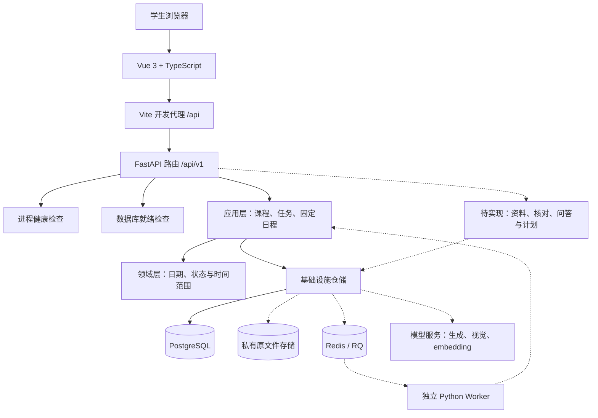
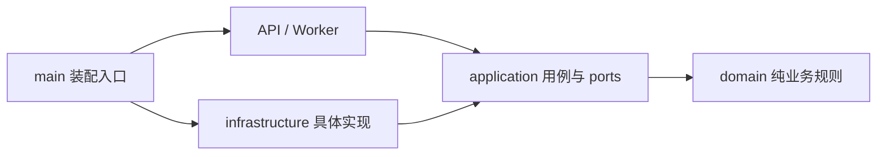
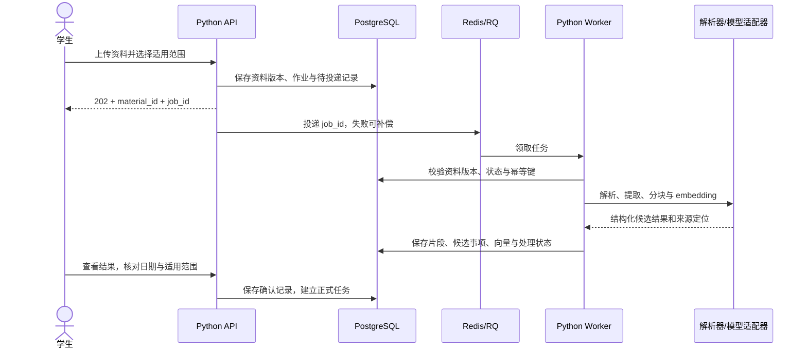

# CampusFlow 技术方案与项目架构

本文确定首期开发基线，业务范围以 [README](../README.md) 和 [AGENTS](../AGENTS.md) 为准。**当前已实现工程骨架、本机单用户会话、PostgreSQL 迁移，以及学期／课程／手动任务与进度历史／固定日程／可用时间／学习偏好的前后端闭环；本整合分支已接入跨工作空间授权、资料上传/解析/定位及 RQ Worker；事项核对、问答与排期尚待实现。** 已合并实现的独立复验与后续任务见 [开发路线](planning/ROADMAP.md)，不以代码存在代替验收通过。

## 1. 总体决策

N005 通过应用用例调用抓取端口，再将原始网页和快照来源信息分别保存到私有文件存储、资料版本记录。API 入口必须先校验会话与空间；不提供公开代理。网页原文按附件返回，不能在应用同源执行。N003 Word 使用 python-docx；N006 网页正文使用用户确认的 Beautiful Soup，经统一 ParserRegistry 接入 Worker，响应编码取自版本来源元数据。网页定位值记录清洗前同类标签的序号（如 p:3），与版本 ID 共同定位原文，正文提取不再次联网。细节见 [N006 说明](verification/N006-web-parsing.md)。

N004 的公开网页抓取使用 Python 标准库：应用层定义抓取结果与错误契约，基础设施实现地址检查、连接固定、逐跳检查及大小和时间上限；未新增外部依赖或公开 HTTP 接口。详细边界见 [N004 说明](verification/N004-public-web-fetch.md)，后续网页导入用例须先执行用户与工作空间授权。

采用单仓库、前后端分离、模块化单体架构。前端提供交互，Python 后端负责业务规则、资料处理与模型编排；耗时工作通过同一个后端包的独立 Worker 进程执行。

四人小组首期需要集中完成业务闭环，因此保持一套后端代码和一套数据模型。API 与 Worker 是不同进程，共享应用层用例，不单独维护微服务接口。仅为已经出现的业务边界增加抽象。

### 技术选型

| 层面 | 选择 | 原因与引入时机 |
| --- | --- | --- |
| 前端 | Vue 3 + TypeScript + Vite | 页面、组件与 API 调用分开，类型检查帮助维护接口；本次建立最小页面。多页时加 Vue Router，有共享状态需求时加 Pinia |
| Python 运行环境 | Python 3.12 + uv | 小组统一解释器小版本，使用 `pyproject.toml` 和 `uv.lock` 管理依赖；本次落地 |
| HTTP API | FastAPI + Uvicorn | Pydantic 校验、OpenAPI 与路由拆分；已注册健康及手动管理接口 |
| 配置 | pydantic-settings | 环境变量与本地 `.env` 注入，配置集中定义；本次落地 |
| 持久化 | PostgreSQL 17 + SQLAlchemy 2 + psycopg 3 + Alembic | 已接入六张基础业务表及迁移；资料、引用和计划模型随功能扩展。默认同步 Session，HTTP 同步数据库路径使用 `def`，不得在 `async def` 中直接执行阻塞 I/O |
| 向量检索 | PostgreSQL 的 pgvector 扩展 | Compose 初始化已启用扩展；向量模型、索引及实际检索在 RAG 阶段实现 |
| 文件存储 | 后端私有本地目录 + 存储接口 | 单实例开发先降低运维成本；文件元数据进数据库，原文件不进 Git。需要多实例时替换为 S3 兼容存储 |
| 资料解析 | pypdf + 可替换 OCR／多模态适配器 | PDF 文本优先直接提取；扫描件和复杂表格走识别流程，保留页码及定位；资料功能阶段引入 |
| AI 与 RAG | 应用层显式流程 + 模型适配接口 | 区分生成、多模态识别和 embedding 能力。具体供应商与模型待授权样本评估、费用和可用性验证后确定，不让 SDK 类型进入业务层 |
| 后台作业 | RQ + Redis 7 + Python Worker | Compose 已提供 Redis；RQ、Worker 和实际作业在资料处理阶段接入。业务状态以 PostgreSQL 为准，Redis 不作为事实来源 |
| 质量检查 | pytest + HTTPX + Ruff；vue-tsc + Vite build | 后端接口和规则测试、格式与静态检查，前端类型检查和构建；本次提供可执行命令 |
| 部署 | 开发时前后端双进程 + 数据库和 Redis Compose | 后续增加 Worker 与同源反向代理；当前没有公网生产部署或认证实现 |

Python 版本写在 `backend/.python-version`，前端建议 Node 24（见 `.nvmrc`，最低 22.12）。应用依赖的精确版本以实际生成的 `uv.lock`、`package-lock.json` 为准，不手工修改锁文件。

### 暂不引入的组件

- Django 管理后台、微服务、Kubernetes：当前主要需求是学生侧 API 和资料处理，暂时没有相应运维或后台管理需求。
- LangChain／LangGraph 等编排框架：先把检索、引用校验和计划确认实现为明确的 Python 用例，需要复杂持久工作流时再评估。
- 独立向量数据库、Elasticsearch：先验证 PostgreSQL + pgvector 的效果；中文关键词检索与混合排序必须用中文样本评估，不假定默认全文检索配置足够。
- 本地大模型／GPU 部署：模型适配接口保留替换能力，首期不要求每个成员配置 GPU。
- UI 组件库、完整日历组件：具体页面原型确定后再引入，当前只有环境联通页。

## 2. 系统架构图

下图保留基础管理链路示意；资料后端的实际启动与装配以 [资料处理运行手册](MATERIAL_PROCESSING.md) 为准。实线表示基础调用链，虚线表示完整资料到事实的后续链路；不表示所有链路已完成阶段验收。浏览器已通过统一 API 客户端接通手动管理业务，并由 Playwright 在真实 PostgreSQL 上覆盖登录、创建、更新、刷新、错误重试和退出保护流程。



开发前端通过 Vite 将 `/api` 转发到 `127.0.0.1:8000`，无需开放通配 CORS。生产目标由同一个域名提供前端静态文件和 `/api`，由反向代理替代 Vite。API、Worker、数据库和文件存储不直接暴露给浏览器。

健康接口 `/api/v1/health` 仅表示 API 进程存活；就绪接口 `/api/v1/ready` 以短超时连接检查数据库连通，不可达时返回 503 且不泄露连接信息或口令。两者都不宣称模型等尚未接入的能力可用。

## 3. 文件分层

以下目录均已建立；标注“预留”的目录目前只包含职责说明，按真实用例逐步添加代码。

```text
CampusFlow/
├── README.md                    # 对外项目计划与开发入口
├── AGENTS.md                    # 业务及工程约定
├── CONTRIBUTING.md              # 小组贡献流程
├── .gitignore
├── backend/
│   ├── pyproject.toml           # Python 依赖与检查配置
│   ├── uv.lock                  # Python 精确依赖锁
│   ├── .python-version
│   ├── .env.example             # 可提交的配置示例
│   ├── src/campusflow/
│   │   ├── main.py              # 应用工厂、依赖装配、路由注册
│   │   ├── core/                # 配置与运行时通用设施
│   │   ├── api/                 # HTTP 路由与输入输出 schema
│   │   ├── application/         # 课程、任务、日程用例及仓储端口
│   │   ├── domain/              # 日期、状态和时间范围业务规则
│   │   ├── infrastructure/      # 数据库与仓储；其余适配器待实现
│   │   └── workers/             # 后台入口、安全日志与只读诊断
│   ├── migrations/             # Alembic 环境及初始六表迁移
│   └── tests/                  # 接口及后续领域、集成测试
├── frontend/
│   ├── package.json
│   ├── package-lock.json
│   ├── .nvmrc
│   ├── vite.config.ts
│   ├── tsconfig.json
│   ├── index.html
│   └── src/
│       ├── main.ts              # 前端入口
│       ├── App.vue              # 应用根组件
│       ├── views/               # 页面
│       ├── components/          # 预留：跨页面共享组件
│       ├── api/                 # HTTP 调用与接口数据处理
│       └── styles.css
├── infra/                      # PostgreSQL、Redis Compose 与初始化脚本
└── docs/
    ├── ARCHITECTURE.md          # 本文：选型、架构、边界
    ├── DEVELOPMENT.md           # 环境与执行命令
    ├── GitLab.md                # 已有仓库连接说明
    └── planning/                # Milestone、Issue、标签与验收覆盖
```

### 后端依赖方向



- `api` 只处理 HTTP 校验、依赖注入、调用用例与响应转换，不直接查库或调用模型。
- 默认工作空间初始化已移至应用用例；对象读取、关联与作业手动补投都校验工作空间范围（W005/W006）。
- `application` 协调流程、事务与授权确认，依赖接口；按 `materials`、`qa`、`tasks`、`planning` 等业务组织文件。
- `domain` 不导入 FastAPI、ORM、供应商 SDK 或运行配置；日期与冲突规则可以脱离服务器独立测试。
- `infrastructure` 实现接口，SQLAlchemy 模型只在该层使用，不直接返回给前端。
- `main`／后续 Worker 启动模块负责组装具体依赖。健康检查无需经过空的 service 和 repository。
- 不预先创建十组空 CRUD 模块或通用基类；第一个实际用例确定后再增加必要文件。

前端页面只通过 `api/` 访问后端。跨页面路由与状态管理按需增加，后端返回的事实与执行结果为准，前端不能把演示数据当成真实任务。

## 4. 关键业务链路设计

### 资料到可查询事实（解析已接入，提取与索引待实现）



上传时校验大小、类型和访问范围，服务端生成存储键，不直接使用用户文件名作为路径。原文件、页码／区域、提取文本和版本要可关联；多个片段不能丢失自己的引用位置。

数据库与队列无法假定原子提交：业务作业和待投递记录在同一事务内保存，投递器重试未投递记录；Worker 接受重复消息但不重复产生结果。失败、部分成功、超时与重试次数应可见，删除或替换的资料版本不得被晚到的任务重新写回索引。

### 检索、回答与计划（待实现）

1. 按工作空间、学期、教学班、资料有效状态过滤，再进行检索；不能先检索全部用户资料后再由模型判断权限。
2. 片段带稳定引用 ID 和版本。模型生成回答后校验引用 ID 存在且在候选集内；仅有合法 ID 不等于语义支持充分，还需用样本评估支持程度。
3. Agent 输出查询／规划／冲突检查意图和结构化参数，后端校验后调用固定用例；任意生成文本不能变成执行命令。
4. 已确认任务进入确定性排期器；先满足固定时间和截止约束，再应用偏好。模型可以解释或建议拆分，不能越过约束验证。
5. 计划以带版本的草案保存；接受操作检查草案版本，过期草案需重新比较，避免覆盖较新的安排。
6. 第三阶段的外部日历适配器仅接受已确认的具体操作，并保存幂等键、外部事件 ID 和逐项结果。

## 5. 数据与接口边界

X007 的 domain/course_matching.py 负责严格名称/班级比较；application/course_matching.py 授权空间、学期、资料版本和证据，附加带原文的课程匹配建议。输出不修改 scope 或正式事项，复用 X001 字段/证据保存为 pending；候选快照不代替确认时的重新授权和范围核验。见 [X007 说明](verification/X007-course-matching.md)。

X006 的 domain/relative_dates.py 只做有限语法日期计算，application/relative_dates.py 先校验空间、版本、范围及原文证据，再向任务候选附加 due_resolution。复用 X001 的字段、证据和 pending 保存机制，无数据库迁移。来源时区由可信调用方明确指定，不读取当前日期或导入日期；不自动确认正式任务。见 [X006 说明](verification/X006-relative-dates.md)。

X001 已实现 ExtractedItem → ExtractedField → CandidateFieldEvidence 的分表关系。纯领域模型与校验位于 domain/candidates.py；应用用例先校验来源及空间，基础设施仓储承担持久化。API 与 Worker 使用同一个仓储装配入口。候选按来源版本级联清理，删除确认包含候选集合，模型输出不能直接变成已确认正式事项。具体契约见 [X001 说明](verification/X001-candidate-evidence.md)。

X004 在 application/event_extraction.py 定义活动字段并复用 X002 的授权与生成入口；domain/event_extraction.py 对活动描述及被引用原文语句做保守检查，拒绝提交截止或混合要求，缺失起止自动补核对原因。该入口只返回草稿，显式使用 X001 保存后仍 pending；不创建 FixedEvent，不换算日期。边界见 [X004 说明](verification/X004-event-extraction.md)。

X002 在 application/ports/generation.py 定义 TextGenerator，仅交换受控提示词、资料 JSON 与模型原始正文；供应商 HTTP 实现位于 infrastructure/llm/text.py，domain 不导入供应商库。application/candidate_generation.py 先检查空间与资料版本，再按调用用例定义的字段契约校验输出；编号必须属于本次输入，摘录必须逐字出现，整批有效才返回草稿，不在生成步骤写库。workers/generation.py 按配置装配，不随启动自动调用。后续 X003–X005 定义各业务字段，X009 继续负责专门的资料指令隔离验收；本项不替代真实语义准确率评测。限制与验证见 [X002 说明](verification/X002-generation-contract.md)。

X003 的 application/task_extraction.py 定义任务专用字段并复用 X002 授权与生成边界；domain/deadline_completeness.py 仅检查截止原文完整性，不依赖模型或系统时间，不生成可排期日期。缺失及建议原因由代码补充，模型不能覆盖。调用方显式使用 X001 保存草稿，仍保持 pending；日期换算及核对交互由后续模块负责，见 [X003 说明](verification/X003-progress.md)。

R002 在 domain/candidates.py 增加 FieldRevision 与 effective_fields：字段修正按追加保存修正前后值、操作者与来源类型，原始提取与证据不改写；application/candidates.py 的 revise_candidate_field 复用同一字段出处规则，用户填写的值不能声明为原文规定，来源只能标为用户补充或规划建议。新表 candidate_field_revisions 由 infrastructure 仓储持久化，候选核对状态仍由 R003 定义转换。见 [R002 说明](verification/R002-field-revisions.md)。

R003 在 domain/candidates.py 定义合法转换、按类型的必需字段与 require_confirmed_for_conversion：确认前检查叠加修正后的生效取值，缺少必需字段默认拒绝、可显式确认并记录原因；被忽略或已失效的候选不参与正式约束。application/candidates.py 的 set_candidate_review_status 更新状态并写入 candidate_review_changes 留痕（方向、操作者、原因、时间），与 task_progress_changes 对齐。见 [R003 说明](verification/R003-review-transitions.md)。

R004 在 domain/candidate_conversion.py 定义任务候选到正式任务的字段映射与截止解析：只有日期的写法不补时刻，相对或无效写法只保留原文到 due_note，日期来源按字段出处映射。application/conversion.py 的 convert_candidate_to_task 要求候选已确认，在一个事务里创建任务并写入 source_material_id 与唯一的 source_candidate_id，重复调用返回既有任务。见 [R004 说明](verification/R004-task-conversion.md)。

R005 在 domain/event_conversion.py 定义日程候选到固定日程的起止解析：必须能解析出日期与时刻，只有日期或相对写法一律拒绝，不按全天或常见时长补造。application/conversion.py 的 convert_candidate_to_event 按工作空间时区换算后复用 validate_fixed_event 校验区间，写入唯一的 source_candidate_id，重复调用返回既有日程。见 [R005 说明](verification/R005-event-conversion.md)。

R006 在 domain/rule_conversion.py 定义规则候选到正式课程规则的字段映射：title 与 rule_text 必需，缺任一项拒绝；conditions／scope／effective 只保留原文，不解析生效日期、不换算相对写法。application/conversion.py 的 convert_candidate_to_rule 要求候选已确认，在一个事务里创建 `course_rules`（迁移 r007_course_rules）并写入 source_material_id 与唯一的 source_candidate_id，重复调用返回既有规则；application/rules.py 的 list_rules 提供按课程／学期过滤的只读查询，`GET /api/v1/rules` 限当前空间。资料删除时规则保留并写入来源失效留痕，删除影响预览计入 linked_rule_ids 与确认指纹。见 [R006 说明](verification/R006-confirmed-rules.md)。

R007 提供任务与日程的来源详情只读接口：`GET /api/v1/tasks/{id}/source` 与 `GET /api/v1/fixed-events/{id}/source`。application/source_detail.py 组合候选原始字段、逐条修正、原文引用与定位，只把仍能定位到原文的引用作为可验证引用返回；domain/source_detail.py 定义来源类型与引用可验证规则。固定日程补齐来源失效留痕（迁移 r006_event_source_invalidation），资料删除时与任务一并写入，删除影响预览新增关联日程并计入确认指纹。见 [R007 说明](verification/R007-source-detail.md)。
X005 的 application/rule_extraction.py 使用 X002 生成接口返回规则候选；domain/rule_extraction.py 校验完整片段及限定语句边界，不依赖模型或数据库。条件/范围/生效信息保留独立证据，未知不推定无条件。调用方显式使用 X001 保存 pending 候选，正式确认由 R 系列处理。见 [X005 说明](verification/X005-rule-extraction.md)。

目标数据分组如下，具体字段和迁移在功能实现时确定：

| 分组 | 对象 | 约束重点 |
| --- | --- | --- |
| 学习背景 | Workspace、Semester、Course | 单用户首期仍保留工作空间边界，同名教学班分开 |
| 证据链 | Material、MaterialVersion、SourceChunk、Citation | 引用绑定版本与定位，原文件放存储，元数据与向量放数据库 |
| 事实与行动 | ExtractedItem、Rule、Task、Event | 核对状态与执行状态分开，DDL 与固定活动时间分开 |
| 计划 | PlanDraft、PlanVersion、TimeBlock、Conflict | 草案与接受状态、乐观版本检查、任务与时间块关联 |
| 后台作业 | ProcessingJob、Outbox | 幂等、重试、待投递补偿、资料失效检查 |
| 外部操作（第三阶段） | Confirmation、ExternalOperation | 确认范围、内容版本、幂等与实际结果 |

统一接口前缀为 `/api/v1`，使用 JSON 与 OpenAPI。未来上传使用 multipart；长任务返回 `202` 和作业 ID，首期通过轮询查看状态，不先引入 WebSocket。

时间采用带时区的 ISO 8601 表示，数据库时间点使用 `timestamptz`，另存原始文本与来源时区。只有日期而没有时刻的 DDL 保留日期精度，不伪装成午夜或 23:59 的确定时间。学校教学周需依赖适用校历换算。

当前业务错误通过 `DomainError` 和 `NotFoundError` 映射为可读消息及 HTTP 400／404，参数校验使用 422。后续完善统一稳定错误码与请求 ID；模型密钥只在后端配置，日志避免原始资料全文和个人信息。

当前实现仅限本机单用户会话：登录成功后颁发 HttpOnly Cookie，退出或服务重启使会话失效，业务路由要求有效会话。共享部署、多人账户和跨工作空间对象授权仍需 W004–W006 后续验收；“单用户”不等于可以把资料公开访问。

## 6. 实施顺序与完成条件

1. **M0–M1：** 工程骨架和首个持久化切片已合并；完成样本、CI、真实数据库复验、身份与空间授权、手动管理前端，形成可验收闭环。
2. **M2–M3：** 私有文件存储、RQ Worker、解析与来源定位、事项提取和核对；验证失败重试与删除派生失效。
3. **M4：** embedding、检索、模型适配器和带引用回答；用中文授权样本评估缺失信息和来源冲突。
4. **M5：** 两周计划、冲突检查和草案接受，完成八项业务 MVP 验收。
5. **M6–M9：** 按第二、第三阶段接入扩展导入、变更、依赖、提醒、导出、课程路径及外部日历。具体完成条件与叶子任务见 [开发路线](planning/ROADMAP.md)。

上述顺序细化 README 的三阶段功能边界。后续依赖在实际使用时加入锁文件，不为未实现能力预装整套 AI SDK。

## Q001 评测准备边界

`scripts/evaluate_qa_preparation.py` 独立于应用运行时，只读取合成样本及离线预设输出，以 B017 口径记录引用支持和不确定性计数；不调用检索器、数据库或供应商，不改变现有业务接口。未知表达保留人工复核，真实模型速度与费用保持未测。真实比较与选型尚待后续工作，见 [准备说明](verification/Q001-preparation.md)。

`scripts/evaluate_qa_live.py` 为独立真实比较入口，默认仅打印计划；显式执行使用用户选定的型号集合与合成样本（默认仍是智谱两向量 × 两对话共四组，可用 `--embedders` / `--generators` 指定其他组合），域名与密钥按模型所属供应商路由，因此可跨供应商比较；预算预留和逐请求响应落盘，停止后可显式继承账本继续。不替代 Q002 的生产向量接口或 Q004 的索引流程；真实引用语义待人工复核，不能把编号合法视为支持正确。首轮中断及已知限制见 [真实评测记录](verification/Q001-live-progress.md)。

## Q003 原文分块边界

Q003 的 `domain/chunking.py` 只做可复现的原文切片，`application/retrieval_blocks.py` 先复用资料/版本授权读取，再生成带来源指纹和字符范围的检索块。分块默认保持原片段边界和全部字符，不修改 D017 来源记录；持久化和向量化留 Q004。位置使用 Unicode 码点而非浏览器 UTF-16 下标，公开引用协议留 Q007，见 [Q003 契约](verification/Q003-source-blocks.md)。

## 7. 官方资料

- [Vue 快速开始](https://vuejs.org/guide/quick-start)、[TypeScript 支持](https://vuejs.org/guide/typescript/overview)、[Vite 入门](https://vite.dev/guide/)：前端工程基线。
- [FastAPI 多文件组织](https://fastapi.tiangolo.com/tutorial/bigger-applications/)：路由拆分；[后台任务边界](https://fastapi.tiangolo.com/tutorial/background-tasks/)：区分进程内任务与独立作业系统。
- [uv 项目管理](https://docs.astral.sh/uv/guides/projects/)：环境和依赖管理；[锁定与同步](https://docs.astral.sh/uv/concepts/projects/sync/)：团队安装使用 `--locked`。
- [SQLAlchemy ORM](https://docs.sqlalchemy.org/en/20/orm/quickstart.html)、[Alembic](https://alembic.sqlalchemy.org/en/latest/)、[pgvector](https://github.com/pgvector/pgvector)：关系数据、迁移和向量存储。
- [RQ](https://python-rq.org/)：Python 作业队列；[pypdf 文本提取](https://pypdf.readthedocs.io/en/stable/user/extract-text.html)：解析能力及 OCR 边界。

## 资料处理运行补充（J009）

Windows 使用 Docker 运行现有 Linux RQ Worker，API 保持本机启动。两端共享同一数据库、Redis 库号和私有原文件目录。解析器注册表组合 PDF 文本解析、扫描页视觉回退与表格关联；数据库迁移分叉通过合并迁移汇合。只读诊断不调用模型，不修改任务，日志及 RQ 失败记录不保存原始异常堆栈。详见 [资料处理运行手册](MATERIAL_PROCESSING.md)。
